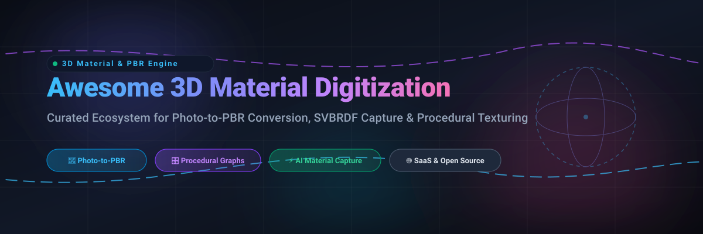

  

# 🎨 Awesome 3D Material Digitization & Capture

  
  
  
  
  
  
  

> 🌟 **A curated list of top SaaS platforms, AI material capture frameworks, and open-source GitHub projects for 3D material digitization, photo-to-PBR conversion, SVBRDF estimation, and procedural texture authoring.**

---

## 📖 Table of Contents
- [✨ Sector Overview & Market Dynamics](#-sector-overview--market-dynamics)
- [☁️ SaaS / Hosted Platforms](#️-saas--hosted-platforms)
- [💻 Open-Source GitHub Projects](#-open-source-github-projects)
- [🤝 How to Contribute](#-how-to-contribute)
- [💖 Support & Sponsorship](#-support--sponsorship)
- [⭐ Star History](#-star-history)
- [⚠️ Disclaimer](#️-disclaimer)

---

## ✨ Sector Overview & Market Dynamics

The global **3D digital asset, material digitization, and surface capture market** is estimated at **$26B–$33B** (with the broader 3D scanning and computer vision hardware/software market growing at a **~13%–19% CAGR** toward $50B+ over the coming decade), driven by surging demand across real-time gaming engines (Unreal Engine 5, Unity), VFX virtual production, architectural visualization, and photorealistic e-commerce digital twins.

Market dynamics reflect a **moderately concentrated, bifurcated ecosystem**:
- **Commercial Tier (Concentrated / Incumbent-led):** High-end commercial production is heavily concentrated around powerhouse ecosystems—primarily Adobe (Substance 3D texturing suite) and Epic Games (Unreal / Quixel ecosystem)—which enjoy strong network effects and pipeline lock-in across major game and film studios.
- **Indie & Open-Source Tier (Rapidly Innovating & Fragmented):** Independent toolmakers and open-source communities are thriving, creating a dynamic alternative layer. Next-generation procedural platforms (such as InstaMAT and Material Maker), zero-install WebGL utilities, and cutting-edge deep learning models (single-image SVBRDF, diffusion-based delighting, and ComfyUI pipelines) provide viable, subscription-free pipelines for indie developers and technical artists.

---

## ☁️ SaaS / Hosted Platforms

| Product | Company / Developer | Company Size (Valuation / Revenue) | Description | Pricing | Free Tier Limit |
| :--- | :--- | :--- | :--- | :--- | :--- |
| **[Adobe Substance 3D Sampler](https://www.adobe.com/products/substance3d/apps/sampler.html)** | Adobe Inc. (NASDAQ: ADBE) | ~$130B–$225B+ market cap (~$21.5B–$23.8B annual revenue) | Photo-to-material capture with AI-assisted delighting, tiling, and PBR map generation, bundled in Adobe's Substance ecosystem. | **Substance 3D Texturing plan**: ~$24.99/month (annual prepaid ~$249.99/year), includes Sampler, Designer, and Painter . **Full Collection**: ~$60/month . | **30-day free trial** via Adobe account . No permanent free tier for the application itself. |
| **[Substance Alchemist](https://www.adobe.com/)** | Adobe Inc. (NASDAQ: ADBE) | ~$130B–$225B+ market cap (~$21.5B–$23.8B annual revenue) | **Legacy name**—Substance Alchemist was renamed to **Substance 3D Sampler** and is no longer a separate product. | See Adobe Substance 3D Sampler above. | See Adobe Substance 3D Sampler above. |
| **[Bitmap2Material](https://store.steampowered.com/)** | Allegorithmic / Adobe Inc. | ~$130B–$225B+ market cap (Allegorithmic acquired by Adobe; ~$15M–$20M revenue prior) | Allegorithmic's (now Adobe) image-to-PBR tool. **Legacy product**—largely superseded by Substance Sampler. | **N/A** on Steam as of 2026; historical lowest recorded price ~$33.49 . | **No current free tier**. Legacy licenses may persist. |
| **[Quixel Mixer](https://quixel.com/mixer)** | Epic Games (Quixel acquired 2019) | ~$22.5B–$31.5B valuation (~$5.3B–$5.6B annual revenue) | **Discontinued.** Final version 2023.1 released free, runs offline indefinitely, no further updates or support . | **Free** (final version, requires Epic Games account) . | **Fully free** final version with 800+ built-in assets, but **no online library access** and no future updates . |
| **[InstaMAT](https://www.instamat.com/)** | Abstract (Abstract Group GmbH & Co. KG) | Mid-sized private studio (bootstrapped; Pioneer tier free under <$100k revenue) | Material authoring and texturing tool positioned as a Substance alternative, with layer-based painting and node workflows. | **Pioneer license**: **Free** for indie artists/studios earning under **$100,000/year**, usable on commercial projects with attribution . Paid tiers available for larger organizations. | **Free Pioneer license** (revenue < $100k/year, attribution required). Native Linux support included . |
| **[ShaderMap Pro](https://shadermap.com/)** | Rendering Systems Inc. | Micro-studio / boutique developer (<$1M est. annual revenue) | Map generation suite converting diffuse/displacement/normal sources into full PBR sets. | Pricing not published in search results (~$49.95 commercial license). Contact vendor. | Not specified in available results. |
| **[Crazybump](https://www.crazybump.com/)** | Ryan Clark | Solo indie developer (<$1M est. annual revenue) | Normal map and texture generation from photos. Shareware with a free evaluation. | **$49** shareware license (version 1.22) . | **Free trial** available; continued use requires purchase. |
| **[Knald](https://www.knaldtech.com/)** | Knald Technologies | Micro-studio / boutique developer (<$1M est. annual revenue) | GPU-accelerated normal/height/AO map generator. | **Freelancer License**: non-commercial use. **Studio License**: commercial use (quote-based) . | **Freelancer License** available (non-commercial only). Commercial use requires Studio license. |
| **[MindTex 2](https://store.steampowered.com/app/441770/MindTex_2/)** | Frozen Flame LLC | Solo indie developer (<$500k est. annual revenue) | Normal map generation utility for game developers and 3D professionals. | **$19.99** on Steam (frequent discounts, e.g., $5.99 during sales) . | **No free tier**. Paid Steam license only. |

---

## 💻 Open-Source GitHub Projects

Curated open-source software, research toolkits, and pipelines for self-hosted material capture, texture synthesis, and PBR authoring. **Sorted in descending order by GitHub_Stars:**

- **[Dream Textures](https://github.com/carson-katri/dream-textures)**   
  🧠 **Stable Diffusion built directly into Blender.** Enables AI-powered PBR texture generation, seamless tiling, inpainting, and concept material creation natively inside the 3D viewport without external cloud dependencies.

- **[Material Maker](https://github.com/RodZill4/material-maker)**   
  🎛️ **The premier open-source procedural material authoring suite.** Built on Godot Engine, Material Maker offers a visual node graph interface for generating complex procedural textures and direct 3D geometry painting—serving as the foremost free alternative to Substance Designer.

- **[ArmorPaint](https://github.com/armory3d/armorpaint)**   
  🖌️ **Open-source 3D PBR texture painting software.** Features GPU-accelerated texture baking, ray-traced material preview on complex meshes, node-driven material creation, and seamless brush painting, positioned as a lightweight, open-source alternative to Substance Painter.

- **[glslViewer](https://github.com/patriciogonzalezvivo/glslViewer)**   
  ⚡ **Console-based GLSL sandbox for 2D/3D shaders and PBR rendering.** Live-reloads shaders with support for image-based lighting (IBL), Cook-Torrance BRDF material evaluation, specular cubemaps, and geometry visualization on desktop and Raspberry Pi.

- **[glTF-Transform](https://github.com/donmccurdy/glTF-Transform)**   
  📦 **Comprehensive glTF 2.0 SDK and CLI for material processing.** Essential for modern 3D pipelines to compress textures (Basis Universal, KTX2, WebP), pack ORM (Occlusion/Roughness/Metallic) channels, deduplicate materials, and optimize game assets.

- **[Materialize](https://github.com/BoundingBoxSoftware/Materialize)**   
  📷 **The classic standalone image-to-PBR converter.** Generates complete PBR map sets (diffuse, normal, height, roughness, metallic, smoothness, edge mask, ambient occlusion) from a single photo with real-time 3D preview and seamless edge tiling sliders.

- **[AwesomeBump](https://github.com/kmkolasinski/AwesomeBump)**   
  🚀 **GPU-accelerated normal and height map generator.** Written in C++ with Qt/OpenGL, processing 99% of image computations on the GPU. Capable of generating normal, height, specular, AO, and roughness maps with fast real-time parameter tweaking.

- **[glTF Sample Viewer](https://github.com/KhronosGroup/glTF-Sample-Viewer)**   
  🎯 **Official Khronos Group glTF 2.0 PBR reference engine.** Provides an authoritative WebGL implementation of standard physically-based rendering, clearcoat, transmission, sheen, and volume extensions for verifying digitized material fidelity.

- **[NormalMap-Online](https://github.com/cpetry/NormalMap-Online)**   
  🌐 **Free in-browser normal and displacement map generator.** A zero-install WebGL application for fast creation of normal, displacement, ambient occlusion, and specular maps directly in web browsers.

- **[diffmat](https://github.com/mit-gfx/diffmat)**   
  🔬 **Differentiable material graph library from MIT GFX.** Uses PyTorch-based differentiable rendering for procedural material capture, recovering complex node-graph parameters and SVBRDF properties directly from multi-view photographs.

- **[Universal Photometric Stereo](https://github.com/satoshi-ikehata/Universal-PS-CVPR2022)**   
  🔦 **Deep learning photometric stereo for surface normal reconstruction.** Official CVPR PyTorch implementation for universal photometric stereo under arbitrary, uncalibrated lighting conditions.

- **[TextureForge](https://github.com/yedp123/Yedp-Texture-Forge)**   
  🛠️ **Zero-install browser material workbench.** Lightweight single-file HTML/React application running completely client-side. Generates normal, roughness, AO, height, and metallic maps with smart clone stamps and 3D preview.

- **[ComfyUI-SuperPBR](https://github.com/Hullabalo/ComfyUI-SuperPBR)**   
  🧩 **AI-assisted PBR decomposition for ComfyUI.** Built on the Base SuperMat model (ICCV) to decompose single renders or photographs into albedo and ORM (occlusion/roughness/metallic) map pairs in a single feed-forward step.

---

## 🤝 How to Contribute

Contributions are warmly welcome! Help keep this 3D material digitization ecosystem up-to-date and comprehensive:

1. 🍴 **Fork** this repository.
2. 🌿 **Create a branch** for your addition (`git checkout -b feature/add-new-tool`).
3. 📝 **Add entries** following the established format:
   - Include tool name, official repository/product link, Stars_Badge (for open-source), and concise descriptive overview.
   - For SaaS products, include pricing, free tier limits, and company size data.
4. 🚀 **Submit a Pull Request** with a brief summary of the project.

---

## 💖 Support & Sponsorship

If you find this curated collection useful for your 3D workflow, game development pipeline, or research, please consider supporting the project:

- ⭐ **Star this repository** to help others discover it!
- 🍴 **Fork and share** with your fellow 3D artists, technical artists, and indie developers.
- ☕ **Buy a coffee & sponsor**: Support ongoing maintenance through the [GitHub Sponsor Dashboard](https://github.com/sponsors/ishandutta2007).

---

## 📈 Star History

---

## ⚠️ Disclaimer

- This is an **independently curated community list** for educational and developer reference. Product names and trademarks belong to their respective owners.
- **Quixel Mixer** is discontinued by Epic Games: the final release (2023.1) is free and operates offline, but receives no future updates or online Megascans library access.
- **Substance Alchemist & Bitmap2Material** are legacy products superseded within Adobe's Substance 3D Sampler ecosystem.
- Commercial usability rules vary for free indie licenses (e.g. InstaMAT Pioneer tier applies only to entities with <$100k annual revenue). Always verify terms for commercial pipelines.
